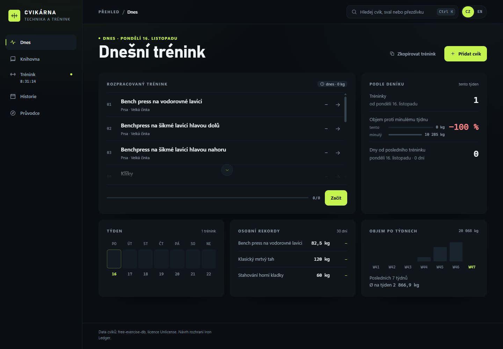

# Cvikárna

Cvikárna is a Czech-first gym app for building muscle with the equipment you have. It carries 120 curated movements with technique and cues, an 876-movement catalogue, a tracker, a month-by-month history and a sourced beginner guide. The app runs on React and TypeScript in the browser, with an ASP.NET Core API and SQLite behind it. Dark theme, Czech and English, demo project.

[github.com/antalnn/cvikarna](https://github.com/antalnn/cvikarna)


## Contents

- [Contents](#contents)
- [Features](#features)
  - [Today](#today)
  - [Library and catalogue](#library-and-catalogue)
  - [Tracker](#tracker)
  - [History](#history)
  - [Guide](#guide)
  - [Language and theme](#language-and-theme)
- [The catalogue](#the-catalogue)
- [Architecture](#architecture)
- [Getting started](#getting-started)
- [Tests](#tests)
- [Data](#data)
- [License](#license)

## Features

### Today

Dnes opens with today's session: its exercises scroll inside the card under a down-arrow cue that floats over the list's own fade, translucent at rest and solid on hover, so the next movement stays half-visible behind it and the card never changes height. The footer carries the completed-set meter and the one action that matters: `Začít` while no set is done, `Pokračovat` once some are, `Upravit` when all are. Beside it sit the week's session count, the volume against last week tinted from accent to danger as it falls, the days since the last workout, the week strip, recent personal records and a seven-week volume spark whose head holds the total and whose note holds the average week. Hovering a day, a record or a bar names its number. Every figure comes from the API, and each number is centred on the text block that describes it.



### Library and catalogue

Knihovna has two tabs. Knihovna lists the movements you saved, 120 on a fresh database, and Katalog lists all 876. Search and the muscle, equipment and level filters apply to both; search ignores diacritics, so `mrty tah` finds `mrtvý tah`, and it forgives one wrong letter in a word of four letters or more. It reads the movement's name, its aliases, its muscle and its equipment, so `zada` and `jednorucky` both land.

Saving is one control per card or row, and its shape states what the click does. A saved card carries a small red cross in a circle, and so does a saved catalogue row; an unsaved row carries a lime plus. The choice survives a reload because it is stored in the API. The catalogue tab in the add-exercise sheet hides what the library already holds, so that sheet only ever answers "what else can I add".

The detail page pairs the free-exercise-db start and end frames with the numbered steps. The art cross-fades the two frames on its own; the two controls inside the frame hold one of them, while the arrows beside the art switch movements. The photo stays clean: the caption and those controls sit over a soft bottom gradient and nothing draws a grid across the picture. The detail page shows the Czech name first and the English name under it when they differ. A catalogue row without a curated Czech name keeps its English name and shows the empty state for its missing steps.


### Tracker

The tracker opens today's session. One card serves every exercise: index, name, subtitle, set dots and a compact total, with a single menu for the movement's detail and its removal. The card expands and collapses from its header, by pointer, Enter and Space. Sets keep a 40px rhythm, a long note truncates on one line, and RPE is one numeral chip tinted by effort, level with the numbers beside it. The next set is the card's last row: its fields sit inside the card's padding with a tinted surface of their own, and the `?` beside RPE opens a short explanation in a panel above the form.

The session bar carries volume, sets and time on the first tier and the progress meter on the second. Its clock slot holds Start while no clock runs and Finish while one does; a reset stops the clock at zero. The rest control beside it follows the timer instead of describing it: a play glyph while no rest runs, a filled pause glyph and the word `Pauza běží` while one does, and a press pauses or resumes exactly as the control inside the timer does. The timer itself breathes while it runs, and the sound tab holds the sound, volume and vibration settings. Copying a past session lists ten a page; picking one replaces today's, and because that is a replace it asks first whenever today already holds exercises.


### History

The calendar marks only days that have exercises, and carries the way back to today inside its own header, beside the month arrows. The month panel lists those workouts, newest or oldest first, with exercise count, set count and volume. When the list runs past the panel, a small down arrow scrolls it; at the oldest session the arrow dims and stops bobbing, keeping its slot so the panel never resizes. A selected workout opens as a read-only log with stat blocks and collapsible exercise cards whose sets are chips, each with its RPE numeral. Deleting it is the red trash in that card's corner, and it asks first in a small popover anchored to the control.


### Guide

The guide covers training, protein, calories, sleep and recovery in five collapsible sections. Each section has key points, bold facts inside the copy and its own sources at the foot of the right column, with the claim each paper supports. Three of the five sections carry a diagram: the rep-range spread, the protein dose plateau and the sleep band. The figure opens that column and the sources close it, so a section without a diagram lines its sources up with the end of the copy instead of letting them sit halfway down. The sourcing is beginner-level guidance, not medical advice.


### Language and theme

Czech is the default and English is one click away. The choice lives in `localStorage`, and every view reads one language at a time. Czech remains the primary language: a movement shows its Czech name where a sourced one exists and its English name where it does not. The theme is dark only, with the Iron Ledger graphite ramp, one lime signal and one spacing scale shared by every page.

## The catalogue

Katalog lists the whole [free-exercise-db](https://github.com/yuhonas/free-exercise-db) set: 876 movements, each with its start and end photo, primary muscle, equipment and level. A saved movement joins the curated 120 in Knihovna; the rest stay one search away in Katalog, and the app is the only inventory you need. No table in this file repeats it.

## Architecture

```text
React 19 + TypeScript
  ├─ Dnes, Knihovna and Katalog, detail, tracker, history, guide
  ├─ one app provider for the session, library, catalogue, rest and clock
  ├─ inline cs/en copy with the Czech name first
  └─ typed fetch client
        │
        ▼
ASP.NET Core 10 minimal API
  ├─ exercises, library membership, catalogue, workouts, sets, stats
  ├─ dashboard, rest settings, copy, reorder, search, validation, DTOs
  └─ EF Core 10 + SQLite
        │
        ▼
SQLite
```

In development Vite proxies `/api` to the API, so the browser sees one origin.

## Getting started

Requirements: .NET 10 SDK and Node 20 or newer.

Start the API from the repository root:

```powershell
dotnet run --project api --launch-profile http
```

The API answers at `http://localhost:5073`. The first run creates `cvikarna.db`, applies the migrations and seeds the 120 library rows and 876 catalogue rows. Swagger is at `http://localhost:5073/swagger` in Development.

Start the web app in a second terminal:

```powershell
cd web
npm install
npm run dev
```

Open `http://localhost:5173`. The tracker needs the API running. The database file is ignored by git. Delete `cvikarna.db` to start from an empty database.

Two query switches help when you are reviewing rather than training. `?boot=0` skips the 1.9s boot sequence, and `?state=loading`, `?state=empty`, `?state=error` or `?state=edge` pins a screen to that state so its skeleton, empty, failure or long-content layout can be seen without provoking it.

## Tests

```powershell
dotnet format --verify-no-changes
dotnet build -warnaserror
dotnet test

cd web
npm run typecheck
npm run lint
npm run lint:ui
npm run build
```

Every command exits 0 on a clean checkout, and that is the check to run first if you only want to know whether the code compiles. `dotnet build -warnaserror` treats every warning as an error, `dotnet test` runs the API suite, and `npm run build` type-checks the web app before Vite writes `web/dist`.

The server suite has 56 tests. It covers search and diacritic normalization, catalogue ids, stats formulas, the read API, muscle, equipment and level filters, workout sessions, set validation, set and exercise reorder, workout names, copying a workout, library membership, the completed flag, rest settings, the dashboard and deleting a workout.

`npm run lint:ui` audits the stylesheet against a baselined class inventory, so an unstyled or orphaned class shows up as a diff rather than as a silent drift.

The layouts were walked at 390, 820 and 1440 px with no horizontal scroll on any screen.

## Data

The 120 curated movements, their English names and their photos come from [free-exercise-db](https://github.com/yuhonas/free-exercise-db), released into the public domain under the Unlicense. Czech names are checked against Czech gym sources that state a page per movement. Eight movements ship the English name because no Czech source names them; [docs/name-sources.md](docs/name-sources.md) records the page behind every Czech name and lists the eight fallbacks.
The catalogue is built from the same dataset. It keeps four display fields per movement and no Czech name outside the curated 120. `nameCs` is null there, and the UI falls back to English instead of inventing a translation. The catalogue's cards and detail page use the free-exercise-db start and end frames by `SourceId`; the curated rows use the local pair under `api/wwwroot/exercises/`. A later session validates any Czech name added to a catalogue row against a real source before it ships.

The guide lists its papers in the app and in [docs/sources.md](docs/sources.md), with the claim each paper supports and what it does not show.

A known limit: the reverse fly photos show the chest-supported version on an incline bench, the only dumbbell rear-delt setup the dataset photographs. The standing version is described in the cues, not shown in a photo.

## License

The application code is MIT. The exercise data from free-exercise-db is public domain under the Unlicense. See [LICENSE](LICENSE).
