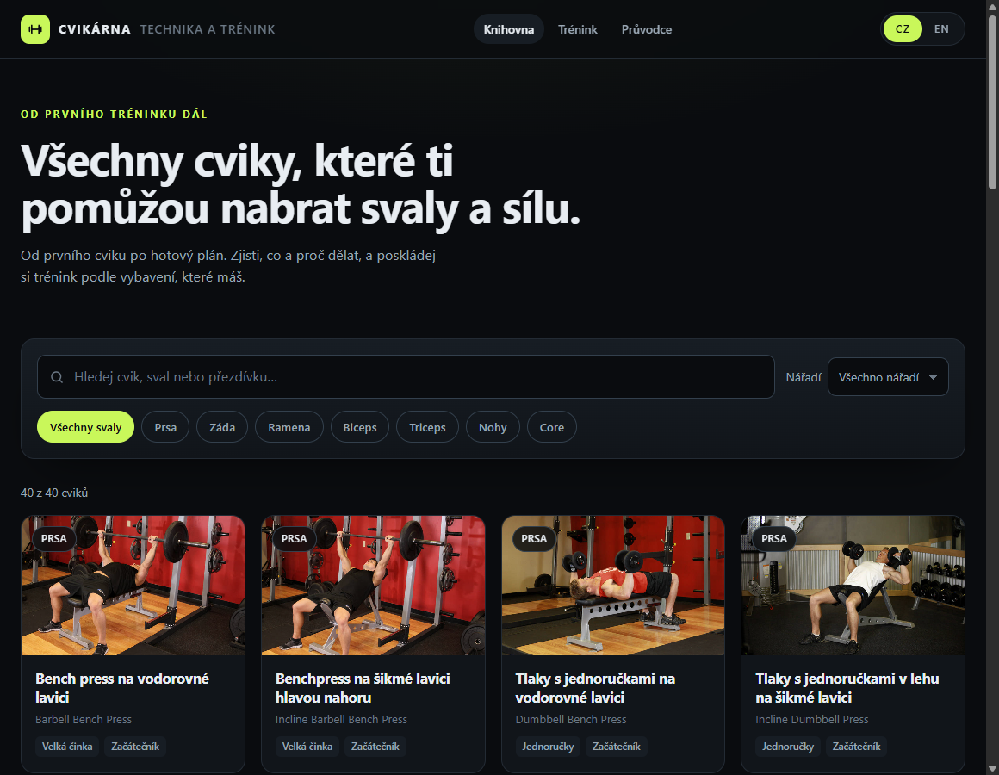
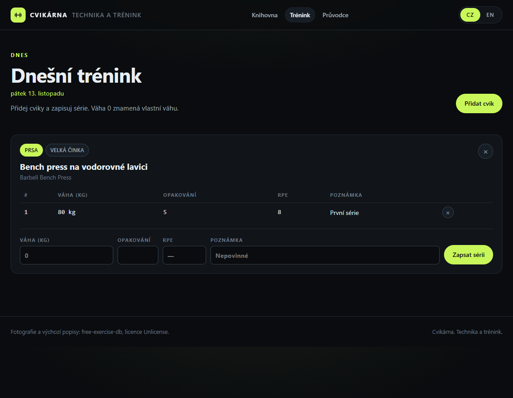

# Cvikárna

Cvikárna is a Czech-first gym exercise library and workout tracker for people who want to train with the equipment they have. It runs in the browser on React and TypeScript, with an ASP.NET Core API and SQLite behind it. It is a demo project, not a production app.

[github.com/antalnn/cvikarna](https://github.com/antalnn/cvikarna)



## Contents

- [Features](#features)
  - [Czech names, not machine translations](#czech-names-not-machine-translations)
  - [Every movement in the dataset](#every-movement-in-the-dataset)
  - [Equipment you actually have](#equipment-you-actually-have)
  - [Numbers with formulas](#numbers-with-formulas)
  - [A guide with sources](#a-guide-with-sources)
- [Architecture](#architecture)
- [Getting started](#getting-started)
- [Tests](#tests)
- [Data](#data)
- [License](#license)

Most trackers are English-first, they only let you log movements from their list, and they assume you already know how to train. Cvikárna is the opposite: Czech names people actually use, every movement in the dataset, a filter for the equipment you own, and a guide that explains the basics.

## Features

### Czech names, not machine translations

The library has 40 curated movements with Czech names checked against Czech gym sources. Every entry carries both languages, aliases, instructions and cues. Search ignores diacritics and one wrong letter, so `mrty tah` finds `mrtvý tah`, and the language switch changes the whole app.

### Every movement in the dataset

The catalogue holds all 876 movements from [free-exercise-db](https://github.com/yuhonas/free-exercise-db) as thin rows. The tracker can log any of them. The 40 library entries keep their photos, technique and coaching text; the rest are name, muscle, equipment and level.



### Equipment you actually have

Filter the library and the picker by barbell, dumbbells, cable, machine, bodyweight, EZ bar or accessory. A beginner with two dumbbells can find a full workout without scrolling past a bench press.

### Numbers with formulas

Volume is weight times reps. Estimated 1RM uses Epley. Personal bests and weekly sets per muscle come from the same logged sets. The formulas live in C# and have unit tests.


### A guide with sources

A beginner page on rep ranges, effort and progression. Every claim names the paper behind it.

## Architecture

```text
React + TypeScript
  ├─ library, detail, tracker, guide
  ├─ hand-rolled cs/en dictionary
  └─ typed fetch client
        │
        ▼
ASP.NET Core minimal API
  ├─ exercises, catalogue, workouts, sets, stats
  ├─ search, validation, DTOs
  └─ EF Core + SQLite
        │
        ▼
SQLite
```

The API serves the exercise images. In development Vite proxies `/api` to the API.

## Getting started

Requirements: .NET 10 SDK and Node 20 or newer.

Start the API from the repository root:

```powershell
dotnet run --project api --launch-profile http
```

The API answers at `http://localhost:5073`. The first run creates `cvikarna.db`, applies the migration and seeds the 40 library rows and 876 catalogue rows. Swagger is at `http://localhost:5073/swagger` in Development.

Start the web app in a second terminal:

```powershell
cd web
npm install
npm run dev
```

Open `http://localhost:5173`. The tracker needs the API running. The database file is ignored by git. Delete `cvikarna.db` to start from an empty database.

## Tests

```powershell
dotnet format --verify-no-changes
dotnet build -warnaserror
dotnet test

cd web
npm run typecheck
npm run lint
npm run build
```

The server suite has 29 tests. It covers search, catalogue ids, stats formulas, the read API, workout sessions and set validation.

## Data

The 40 curated movements, their English names and their photos come from [free-exercise-db](https://github.com/yuhonas/free-exercise-db), released into the public domain under the Unlicense. Czech names are checked against Czech gym sources.

The catalogue is built from the same dataset. It keeps four display fields per movement and no Czech name outside the curated 40. `nameCs` is null there, and the UI falls back to English instead of inventing a translation.

A known limit: the reverse fly photos show the chest-supported version on an incline bench, the only dumbbell rear-delt setup the dataset photographs. The standing version is described in the cues, not shown in a photo.

## License

The application code is MIT. The exercise data from free-exercise-db is public domain under the Unlicense. See [LICENSE](LICENSE).
