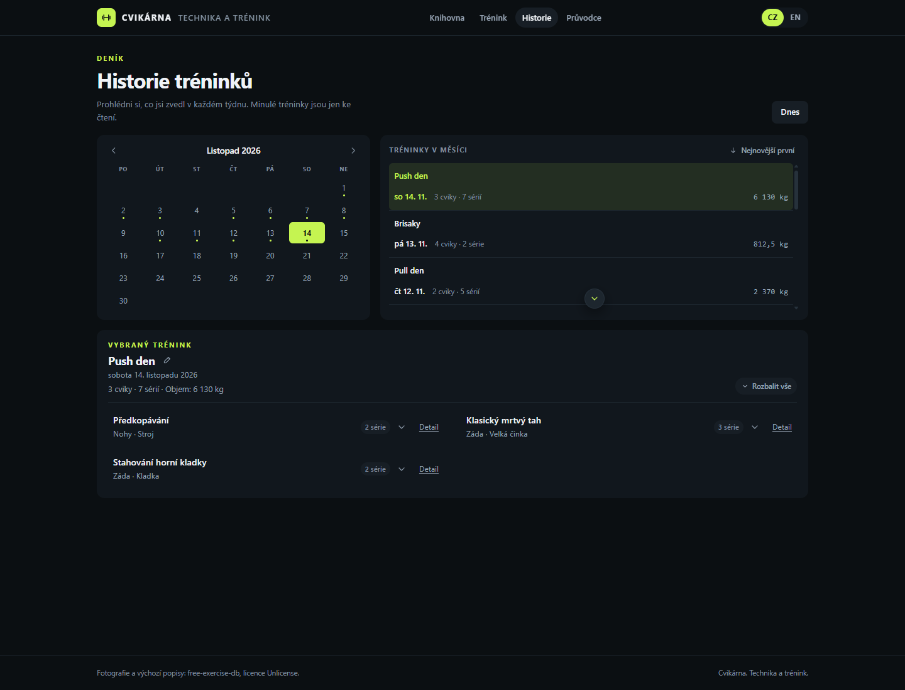

# Cvikárna

Cvikárna is a Czech-first gym app for building muscle with the equipment you have. It carries 120 curated movements with technique and cues, an 876-movement catalogue, a tracker, a month-by-month history and a sourced beginner guide. The app runs on React and TypeScript in the browser, with an ASP.NET Core API and SQLite behind it. Dark theme, Czech and English, demo project.

[github.com/antalnn/cvikarna](https://github.com/antalnn/cvikarna)


## Contents

- [Contents](#contents)
- [Features](#features)
  - [Library and technique](#library-and-technique)
  - [Tracker](#tracker)
  - [History](#history)
  - [Guide](#guide)
  - [Language and theme](#language-and-theme)
- [The exercise library](#the-exercise-library)
- [Architecture](#architecture)
- [Getting started](#getting-started)
- [Tests](#tests)
- [Data](#data)
- [License](#license)

## Features

### Library and technique

The library holds 120 movements with a photo, both names, aliases, numbered steps and cues. Filter by muscle group, by the equipment you own and by level. Search ignores diacritics, so `mrty tah` finds `mrtvý tah`, and it forgives one wrong letter in a word of four letters or more. The grid renders 20 movements at a time and appends the next 20 with a button, so a filter or search change always starts from the top. The detail page pairs the demonstration photo with the numbered steps, then lists the cues as plain lines and ends with similar movements.


### Tracker

The tracker opens today's session. Name it, and rename it later from the pencil beside the title. Add a movement from the library or from the full catalogue, then log weight, reps, RPE and a note for each set. The RPE question mark explains the 1 to 10 scale. Drag a set or an exercise to reorder it, or focus its handle and press Arrow Up or Arrow Down. Copy a past workout replaces today's session with the source's exercises, sets, weights, reps, RPE, notes and name.


### History

The calendar marks only days that have exercises. The month panel lists those workouts, newest or oldest first, with exercise count, set count and volume. When the list runs past the panel, a small down arrow scrolls it, and the arrow disappears at the bottom. A selected workout opens as a read-only log with collapsible exercise groups, one shared column header and a Detail link per movement. A named workout shows its name in the month list and above the date, and the pencil there renames it without leaving the page.



### Guide

The guide covers training, protein, calories, sleep and recovery in five collapsible sections. Each section has key points, bold facts inside the copy and its own sources with the claim each paper supports. Three of the five sections also carry a diagram: the rep-range spread, the protein dose plateau and the sleep band. The sourcing is beginner-level guidance, not medical advice.


### Language and theme

Czech is the default and English is one click away. The choice lives in `localStorage`, and every view reads one language at a time. The theme is dark only, with a lime accent and one spacing scale shared by every page.

## The exercise library

The 120 curated movements, grouped by primary muscle. The Czech name is the one the app shows by default, and the English name is what the other language switches to. The watch-for line is the first cue from the seed data, not a new summary. Eight movements use the English name because no Czech source page names them, and a few keep an English term that Czech gyms use (Plank, Superman, Farmer's walk); [docs/name-sources.md](docs/name-sources.md) records which is which.

**Chest**

| Czech name | English name | Equipment | Level | Watch for |
| --- | --- | --- | --- | --- |
| Bench press na vodorovné lavici | Barbell Bench Press | Barbell | Beginner | Keep the shoulder blades pinched for the whole set. |
| Benchpress na šikmé lavici hlavou nahoru | Incline Barbell Bench Press | Barbell | Beginner | Do not let the bench angle turn this into a shoulder press. |
| Tlaky s jednoručkami na vodorovné lavici | Dumbbell Bench Press | Dumbbells | Beginner | Dumbbells travel in a slight arc, not straight up. |
| Tlaky s jednoručkami v lehu na šikmé lavici | Incline Dumbbell Press | Dumbbells | Beginner | Keep the elbows at about 45 degrees from the torso. |
| Stahování protisměrných kladek | Cable Crossover | Cable | Beginner | Think about hugging a tree, not pressing. |
| Rozpažky na vodorovné lavici | Dumbbell Fly | Dumbbells | Beginner | This is a stretch, not a press, keep the elbow angle fixed. |
| Kliky | Pushups | Bodyweight | Beginner | The hands stay under the shoulders, not in front of them. |
| Benchpress na šikmé lavici hlavou dolů | Decline Barbell Bench Press | Barbell | Beginner | Lower the bar to the lower chest, not toward the stomach. |
| Rozpažky s jednoručkami na šikmé lavici | Incline Dumbbell Flyes | Dumbbells | Beginner | The elbow angle stays fixed, this is not a press. |
| Tlaky s jednoručkami na vodorovné lavici neutrálním úchopem | Dumbbell Bench Press with Neutral Grip | Dumbbells | Beginner | The wrists stay stacked over the elbows the whole way. |
| Rozpažování na protisměrných kladkách vleže | Flat Bench Cable Flyes | Cable | Intermediate | The elbows keep the same small bend throughout. |
| Tlaky na šikmé lavici na spodních kladkách | Incline Cable Chest Press | Cable | Beginner | Keep the wrists over the elbows, not behind them. |
| Tlaky na prsa na kladce ve stoje | Cable Chest Press | Cable | Beginner | The torso stays upright, do not lean into the press. |
| Tlaky na stroji na prsa | Machine Bench Press | Machine | Beginner | Keep the shoulders down and back against the pad. |
| Kliky na bradlech | Dips - Chest Version | Accessory | Intermediate | Lean forward to keep the work on the chest. |
| Kliky o vyvýšenou podložku | Incline Push-Up | Bodyweight | Beginner | The higher the hands, the easier the rep. |
| Svend press | Svend Press | Accessory | Beginner | Press the palms into the plates the whole time. |

**Back**

| Czech name | English name | Equipment | Level | Watch for |
| --- | --- | --- | --- | --- |
| Klasický mrtvý tah | Barbell Deadlift | Barbell | Intermediate | The bar stays in contact with the legs the whole way up. |
| Přítahy osy v předklonu | Bent-Over Barbell Row | Barbell | Beginner | Pull with the elbows, not the hands. |
| Shyby nadhmatem | Pull-Up | Bodyweight | Beginner | Start the pull from the shoulder blades, not the arms. |
| Stahování horní kladky | Wide-Grip Lat Pulldown | Cable | Beginner | Aim the chest up to meet the bar. |
| Přítahy spodní kladky | Seated Cable Row | Cable | Beginner | Keep the torso upright, do not row with the lower back. |
| Přítahy jednoručky v předklonu | One-Arm Dumbbell Row | Dumbbells | Beginner | Do not rotate the torso to lift the weight. |
| Shyby podhmatem | Chin-Up | Bodyweight | Beginner | Start the pull from the shoulder blades, not the arms. |
| Krčení ramen s osou | Barbell Shrug | Barbell | Beginner | Do not roll the shoulders, go straight up and down. |
| Přítahy jednoruček v předklonu | Bent Over Two-Dumbbell Row | Dumbbells | Beginner | The torso stays still, do not rise up with each rep. |
| Přítahy na T-ose | T-Bar Row with Handle | Barbell | Beginner | Keep the chest up and the back flat. |
| Přítahy v náklonu | Inverted Row | Accessory | Beginner | Squeeze the glutes so the hips stay in line. |
| Stahování kladky s napnutými pažemi | Straight-Arm Pulldown | Cable | Beginner | Only the shoulders move, the elbows stay locked. |
| Stahování horní kladky s V-madlem | V-Bar Pulldown | Cable | Intermediate | Let the shoulder blades rise at the top, then pull them down. |
| Stahování horní kladky podhmatem | Underhand Cable Pulldowns | Cable | Beginner | Keep the wrists straight, do not curl them. |
| Přítahy jednoruček na šikmé lavici | Dumbbell Incline Row | Dumbbells | Beginner | Keep the chest on the pad for the whole set. |
| Veslování v lehu na pákovém T-bar stroji | Lying T-Bar Row | Machine | Intermediate | Keep the chest glued to the pad for the whole set. |
| Rack pull | Rack Pulls | Barbell | Intermediate | Start from a dead stop, do not bounce the bar off the pins. |
| Deficitní mrtvý tah | Deficit Deadlift | Barbell | Intermediate | The longer range makes the start harder, so use less weight than your normal deadlift. |
| Hyperextenze | Hyperextensions (Back Extensions) | Accessory | Beginner | Stop at a straight line, do not arch past it. |
| Superman | Superman | Bodyweight | Beginner | Lift with the back and glutes, do not throw the head up. |

**Shoulders**

| Czech name | English name | Equipment | Level | Watch for |
| --- | --- | --- | --- | --- |
| Tlaky s osou v sedě | Seated Barbell Press | Barbell | Intermediate | Keep the ribs down, do not arch to finish the press. |
| Tlaky s jednoručkami v sedě | Dumbbell Shoulder Press | Dumbbells | Intermediate | Keep the elbows slightly in front of the shoulders. |
| Upažování s jednoručkami | Side Lateral Raise | Dumbbells | Beginner | Lead with the elbows, not the hands. |
| Upažování s jednoručkami v předklonu | Reverse Fly | Dumbbells | Beginner | Think about squeezing the shoulder blades together. |
| Face pull | Face Pull | Cable | Intermediate | Finish with the hands beside the ears and the elbows high. |
| Arnold press | Arnold Dumbbell Press | Dumbbells | Intermediate | Rotate smoothly, the turn happens through the press. |
| Předpažování s jednoručkami | Front Dumbbell Raise | Dumbbells | Beginner | Stop at shoulder height, higher is not better. |
| Upažování na kladce v sedě | Cable Seated Lateral Raise | Cable | Beginner | Keep the torso still against the bench. |
| Upažování v předklonu v sedě | Seated Bent-Over Rear Delt Raise | Dumbbells | Intermediate | Keep the chest down, do not sit up as you lift. |
| Obrácený motýlek | Reverse Machine Flyes | Machine | Beginner | Keep the chest on the pad. |
| Rozpažování na zadní ramena na kladce | Cable Rear Delt Fly | Cable | Beginner | Keep the elbow almost straight, only the shoulder moves. |
| Tlaky na ramenním stroji | Machine Shoulder (Military) Press | Machine | Beginner | Keep the back on the pad the whole time. |
| Push press | Push Press | Barbell | Expert | The dip is short and vertical, the torso stays upright. |
| Přítahy osy k bradě | Upright Barbell Row | Barbell | Beginner | Stop at chest height, higher is not better. |
| Tlaky s osou ve stoji | Standing Military Press | Barbell | Beginner | Keep the ribs down, do not arch to finish the press. |
| Skapce s jednoručkami | Dumbbell Scaption | Dumbbells | Beginner | Keep the thumbs up for the whole rep. |
| Roztahování gumičky | Band Pull Apart | Accessory | Beginner | Keep the elbows straight, do not bend them. |

**Biceps**

| Czech name | English name | Equipment | Level | Watch for |
| --- | --- | --- | --- | --- |
| Bicepsový zdvih s osou ve stoje | Barbell Curl | Barbell | Beginner | The elbows stay still, only the forearms move. |
| Bicepsový zdvih s jednoručkami | Dumbbell Curl | Dumbbells | Beginner | Rotating the wrist slightly outward adds a squeeze. |
| Kladivový zdvih s jednoručkami | Hammer Curl | Dumbbells | Beginner | The thumbs point up the whole time. |
| Bicepsový zdvih na Scottově lavici | Preacher Curl | Barbell | Beginner | The pad does the cheating prevention for you, use it. |
| Bicepsový zdvih s EZ osou | EZ-Bar Curl | EZ bar | Beginner | The elbows stay still, only the forearms move. |
| Koncentrované zdvihy s jednoručkou | Concentration Curls | Dumbbells | Beginner | Keep the elbow pressed against the thigh. |
| Bicepsový zdvih na šikmé lavici | Incline Dumbbell Curl | Dumbbells | Beginner | Keep the upper arms still, the stretch at the bottom is the point. |
| Cross Body Hammer Curl | Cross Body Hammer Curl | Dumbbells | Beginner | The elbow stays still, the forearm does the curling. |
| Kladivové zdvihy na kladce s lanem | Cable Hammer Curls - Rope Attachment | Cable | Beginner | Keep both ends of the rope level. |
| Bicepsový zdvih velkou činkou nadhmatem | Reverse Barbell Curl | Barbell | Beginner | Use less weight than you would on a normal curl. |
| Spider Curl | Spider Curl | EZ bar | Beginner | Keep the chest on the pad, do not lift it to cheat the rep. |
| Incline Hammer Curls | Incline Hammer Curls | Dumbbells | Beginner | The stretch at the bottom is the point, do not cut it short. |
| Zottmanův zdvih | Zottman Curl | Dumbbells | Intermediate | Lower more slowly than you curl. |

**Triceps**

| Czech name | English name | Equipment | Level | Watch for |
| --- | --- | --- | --- | --- |
| Benchpress na úzko | Close-Grip Bench Press | Barbell | Beginner | The wrists stay over the elbows, no flaring out. |
| Tricepsový zdvih osy v lehu | Lying Triceps Extension | EZ bar | Intermediate | Only the forearms move. |
| Stahování lana na triceps | Rope Triceps Pushdown | Cable | Beginner | Keep the elbows glued to the sides. |
| Tricepsové stahování horní kladky s lanem přes hlavu | Overhead Cable Triceps Extension | Cable | Beginner | Keep the upper arms beside the head, not moving. |
| Tricepsové kliky na bradlech | Dips - Triceps Version | Bodyweight | Beginner | An upright torso keeps the work on the triceps. |
| Tricepsové kliky o lavičku | Bench Dips | Bodyweight | Beginner | Keep the hips close to the bench. |
| Francouzský tlak s EZ osou v lehu | EZ-Bar Skullcrusher | EZ bar | Beginner | Only the elbows bend, the upper arms stay still. |
| Stahování kladky na triceps | Triceps Pushdown | Cable | Beginner | Only the forearms move, the elbows stay put. |
| Reverse Grip Triceps Pushdown | Reverse Grip Triceps Pushdown | Cable | Beginner | Keep the wrists straight, they will want to bend. |
| Triceps Overhead Extension with Rope | Triceps Overhead Extension with Rope | Cable | Beginner | Keep the elbows narrow, they flare out when the weight is too heavy. |
| Francouzský tlak s jednoručkou | Dumbbell One-Arm Triceps Extension | Dumbbells | Intermediate | Keep the elbow pointing at the ceiling. |
| Tricepsové zapažování | Tricep Dumbbell Kickback | Dumbbells | Beginner | The upper arm does not move, it stays locked in place. |
| Floor Press | Floor Press | Barbell | Intermediate | Do not bounce the elbows off the floor. |

**Quads**

| Czech name | English name | Equipment | Level | Watch for |
| --- | --- | --- | --- | --- |
| Dřep s osou za hlavou | Barbell Back Squat | Barbell | Beginner | Knees track over the toes. |
| Dřep s činkou vpředu | Front Squat | Barbell | Expert | If the elbows drop, the bar drops. |
| Legpress na šikmé lavici | Leg Press | Machine | Beginner | Do not let the lower back round off the pad. |
| Předkopávání | Leg Extension | Machine | Beginner | Squeeze the quads at the top for a second. |
| Výpady v chůzi | Walking Lunge | Barbell | Beginner | The front knee stays over the foot. |
| Smith Machine Squat | Smith Machine Squat | Machine | Beginner | Place the feet a little forward so the fixed bar path stays over the midfoot. |
| Výpady s osou | Barbell Lunge | Barbell | Intermediate | Keep the front knee over the foot, not past the toes. |
| Dřep na bednu | Box Squat | Barbell | Intermediate | Sit back, not straight down. |
| Goblet squat | Goblet Squat | Accessory | Beginner | The weight at the chest keeps the torso upright. |
| Hack squat | Hack Squat | Machine | Beginner | Keep the back and hips against the pad for the whole rep. |
| Výpady s jednoručkami | Dumbbell Lunges | Dumbbells | Beginner | Take a long enough step that the front shin stays close to vertical. |
| Výstupy na bednu s osou | Barbell Step Ups | Barbell | Intermediate | Put the whole foot on the box, not just the toes. |
| Dřep s vlastní vahou | Bodyweight Squat | Bodyweight | Beginner | Knees travel in the direction of the toes. |

**Hamstrings**

| Czech name | English name | Equipment | Level | Watch for |
| --- | --- | --- | --- | --- |
| Rumunský mrtvý tah | Romanian Deadlift | Barbell | Intermediate | The bar stays in contact with the thighs. |
| Zakopávání v leže | Lying Leg Curl | Machine | Beginner | Keep the hips on the pad, do not lift them. |
| Good morning s osou | Good Morning | Barbell | Intermediate | The movement is the hips going back, not the chest going down. |
| Zakopávání v sedě | Seated Leg Curl | Machine | Beginner | Keep the hips down in the seat, do not let them lift. |
| Mrtvý tah s rovnýma nohama | Stiff-Legged Barbell Deadlift | Barbell | Intermediate | The bar stays in contact with the legs the whole way down. |
| Sumo mrtvý tah | Sumo Deadlift | Barbell | Intermediate | Knees track out over the toes the whole way up. |
| Glute ham raise | Glute Ham Raise | Machine | Intermediate | Squeeze the glutes so the hips stay in line with the torso. |

**Glutes**

| Czech name | English name | Equipment | Level | Watch for |
| --- | --- | --- | --- | --- |
| Hip thrust | Barbell Hip Thrust | Barbell | Intermediate | Tuck the chin and keep the ribs down at the top. |
| Glute bridge s osou | Barbell Glute Bridge | Barbell | Intermediate | Tuck the chin and keep the ribs down at the top. |
| Zanožování na kladce | One-Legged Cable Kickback | Cable | Intermediate | The movement comes from the hip, not from the lower back. |
| Pull through | Pull Through | Cable | Beginner | The hips go back and the knees stay softly bent. |

**Calves**

| Czech name | English name | Equipment | Level | Watch for |
| --- | --- | --- | --- | --- |
| Výpony na lýtka ve stoje | Standing Calf Raise | Machine | Beginner | Full range, from deep stretch to full contraction. |
| Výpony na lýtka v sedě | Seated Calf Raise | Machine | Beginner | The bent knee targets the soleus, that is intended. |
| Výpony na legpressu | Calf Press On The Leg Press Machine | Machine | Beginner | Keep the knees almost straight but not hard locked. |
| Výpony s jednoručkami ve stoje | Standing Dumbbell Calf Raise | Dumbbells | Intermediate | Pause for a moment at the top of each rep. |

**Core**

| Czech name | English name | Equipment | Level | Watch for |
| --- | --- | --- | --- | --- |
| Plank | Plank | Bodyweight | Beginner | Pull the belly button toward the spine. |
| Vznosy ve visu | Hanging Leg Raise | Bodyweight | Expert | Curl the pelvis up, do not just lift the legs. |
| Zkracovačky na horní kladce | Cable Crunch | Cable | Beginner | Crunch the ribs down, do not pull with the arms. |
| Rollout s kolečkem | Ab Roller Rollout | Accessory | Intermediate | Go only as far as you can keep the ribs down. |
| Pallof press | Pallof Press | Cable | Beginner | Resist the pull, do not let the torso twist. |
| Zkracovačky | Crunches | Bodyweight | Beginner | Do not pull on the head with the hands. |
| Pike ve visu | Hanging Pike | Bodyweight | Expert | Start the rep from the pelvis, not from the feet. |
| Ruský twist | Russian Twist | Bodyweight | Intermediate | Rotate the ribs, not just the arms. |
| Boční plank | Side Bridge | Bodyweight | Beginner | Push the forearm into the floor to stay stable. |
| Zkracovačky na šikmé lavici hlavou dolů | Decline Crunch | Bodyweight | Intermediate | The range is short, do not sit all the way up. |

**Grip**

| Czech name | English name | Equipment | Level | Watch for |
| --- | --- | --- | --- | --- |
| Farmer's walk | Farmer's Walk | Accessory | Intermediate | Do not shrug or lean to one side. |
| Plate Pinch | Plate Pinch | Accessory | Intermediate | The thumb works as hard as the fingers. |


## Architecture

```text
React 19 + TypeScript
  ├─ library, detail, tracker, history, guide
  ├─ hand-rolled cs/en dictionary
  └─ typed fetch client
        │
        ▼
ASP.NET Core 10 minimal API
  ├─ exercises, catalogue, workouts, sets, stats
  ├─ names, copy, reorder, search, validation, DTOs
  └─ EF Core 10 + SQLite
        │
        ▼
SQLite
```

In development Vite proxies `/api` to the API, so the browser sees one origin.

## Getting started

Requirements: .NET 10 SDK and Node 20 or newer.

Start the API from the repository root:

```powershell
dotnet run --project api --launch-profile http
```

The API answers at `http://localhost:5073`. The first run creates `cvikarna.db`, applies the migrations and seeds the 120 library rows and 876 catalogue rows. Swagger is at `http://localhost:5073/swagger` in Development.

Start the web app in a second terminal:

```powershell
cd web
npm install
npm run dev
```

Open `http://localhost:5173`. The tracker needs the API running. The database file is ignored by git. Delete `cvikarna.db` to start from an empty database.

## Tests

```powershell
dotnet format --verify-no-changes
dotnet build -warnaserror
dotnet test

cd web
npm run typecheck
npm run lint
npm run build
```

The server suite has 50 tests. It covers search and diacritic normalization, catalogue ids, stats formulas, the read API, muscle, equipment and level filters, workout sessions, set validation, set and exercise reorder, workout names and copying a workout.

## Data

The 120 curated movements, their English names and their photos come from [free-exercise-db](https://github.com/yuhonas/free-exercise-db), released into the public domain under the Unlicense. Czech names are checked against Czech gym sources that state a page per movement. Eight movements ship the English name because no Czech source names them; [docs/name-sources.md](docs/name-sources.md) records the page behind every Czech name and lists the eight fallbacks.
The catalogue is built from the same dataset. It keeps four display fields per movement and no Czech name outside the curated 120. `nameCs` is null there, and the UI falls back to English instead of inventing a translation.

The guide lists its papers in the app and in [docs/sources.md](docs/sources.md), with the claim each paper supports and what it does not show.

A known limit: the reverse fly photos show the chest-supported version on an incline bench, the only dumbbell rear-delt setup the dataset photographs. The standing version is described in the cues, not shown in a photo.

## License

The application code is MIT. The exercise data from free-exercise-db is public domain under the Unlicense. See [LICENSE](LICENSE).
