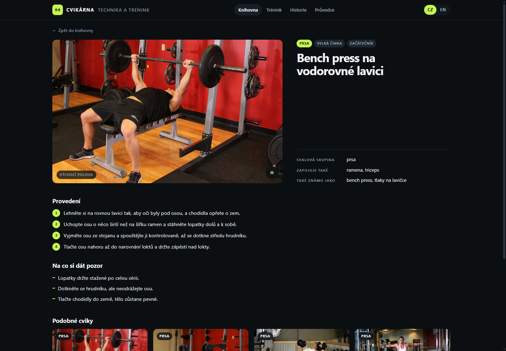
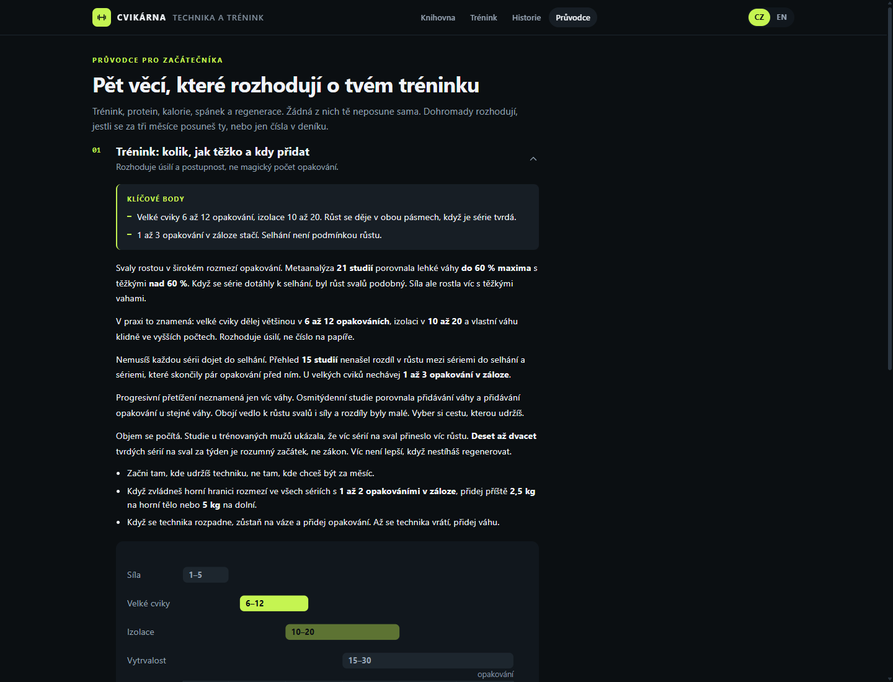

# Cvikárna

Cvikárna is a Czech-first gym app for building muscle with the equipment you have. It carries 40 curated movements with technique and cues, an 876-movement catalogue, a tracker, a month-by-month history and a sourced beginner guide. The app runs on React and TypeScript in the browser, with an ASP.NET Core API and SQLite behind it. Dark theme, Czech and English, demo project.

[github.com/antalnn/cvikarna](https://github.com/antalnn/cvikarna)


## Contents

- [Contents](#contents)
- [Features](#features)
  - [Library and technique](#library-and-technique)
  - [Tracker](#tracker)
  - [History](#history)
  - [Guide](#guide)
  - [Language and theme](#language-and-theme)
- [The exercise library](#the-exercise-library)
- [Architecture](#architecture)
- [Getting started](#getting-started)
- [Tests](#tests)
- [Data](#data)
- [License](#license)

## Features

### Library and technique

The library holds 40 movements with a photo, both names, aliases, numbered steps and cues. Filter by muscle group and by the equipment you own. Search ignores diacritics, so `mrty tah` finds `mrtvý tah`, and it forgives one wrong letter in a word of four letters or more. The detail page pairs the demonstration photo with the numbered steps, then lists the cues as plain lines and ends with similar movements.



### Tracker

The tracker opens today's session. Name it, and rename it later from the pencil beside the title. Add a movement from the library or from the full catalogue, then log weight, reps, RPE and a note for each set. The RPE question mark explains the 1 to 10 scale. Drag a set or an exercise to reorder it, or focus its handle and press Arrow Up or Arrow Down. Copy a past workout repeats its exercises, sets, weights, reps, RPE and notes in today's session, in the same order.


### History

The calendar marks only days that have exercises. The month panel lists those workouts, newest or oldest first, with exercise count, set count and volume. A selected workout opens as a read-only log with collapsible exercise groups, one shared column header and a Detail link per movement. A named workout shows its name in the month list and above the date, and the pencil there renames it without leaving the page.


### Guide

The guide covers training, protein, calories, sleep and recovery in five collapsible sections. Each section has key points, bold facts inside the copy and its own sources with the claim each paper supports. Three of the five sections also carry a diagram: the rep-range spread, the protein dose plateau and the sleep band. The sourcing is beginner-level guidance, not medical advice.



### Language and theme

Czech is the default and English is one click away. The choice lives in `localStorage`, and every view reads one language at a time. The theme is dark only, with a lime accent and one spacing scale shared by every page.

## The exercise library

The 40 curated movements, grouped by primary muscle. The Czech name is the one the app shows by default, and the English name is what the other language switches to. The watch-for line is the first cue from the seed data, not a new summary.

**Chest**

| Czech name | English name | Equipment | Level | Watch for |
| --- | --- | --- | --- | --- |
| Bench press na vodorovné lavici | Barbell Bench Press | Barbell | Beginner | Keep the shoulder blades pinched for the whole set. |
| Benchpress na šikmé lavici hlavou nahoru | Incline Barbell Bench Press | Barbell | Beginner | Do not let the bench angle turn this into a shoulder press. |
| Tlaky s jednoručkami na vodorovné lavici | Dumbbell Bench Press | Dumbbells | Beginner | Dumbbells travel in a slight arc, not straight up. |
| Tlaky s jednoručkami v lehu na šikmé lavici | Incline Dumbbell Press | Dumbbells | Beginner | Keep the elbows at about 45 degrees from the torso. |
| Stahování protisměrných kladek | Cable Crossover | Cable | Beginner | Think about hugging a tree, not pressing. |
| Rozpažky na vodorovné lavici | Dumbbell Fly | Dumbbells | Beginner | This is a stretch, not a press, keep the elbow angle fixed. |

**Back**

| Czech name | English name | Equipment | Level | Watch for |
| --- | --- | --- | --- | --- |
| Klasický mrtvý tah | Barbell Deadlift | Barbell | Intermediate | The bar stays in contact with the legs the whole way up. |
| Přítahy osy v předklonu | Bent-Over Barbell Row | Barbell | Beginner | Pull with the elbows, not the hands. |
| Shyby nadhmatem | Pull-Up | Bodyweight | Beginner | Start the pull from the shoulder blades, not the arms. |
| Stahování horní kladky | Wide-Grip Lat Pulldown | Cable | Beginner | Aim the chest up to meet the bar. |
| Přítahy spodní kladky | Seated Cable Row | Cable | Beginner | Keep the torso upright, do not row with the lower back. |
| Přítahy jednoručky v předklonu | One-Arm Dumbbell Row | Dumbbells | Beginner | Do not rotate the torso to lift the weight. |

**Shoulders**

| Czech name | English name | Equipment | Level | Watch for |
| --- | --- | --- | --- | --- |
| Tlaky s osou v sedě | Seated Barbell Press | Barbell | Intermediate | Keep the ribs down, do not arch to finish the press. |
| Tlaky s jednoručkami v sedě | Dumbbell Shoulder Press | Dumbbells | Intermediate | Keep the elbows slightly in front of the shoulders. |
| Upažování s jednoručkami | Side Lateral Raise | Dumbbells | Beginner | Lead with the elbows, not the hands. |
| Upažování s jednoručkami v předklonu | Reverse Fly | Dumbbells | Beginner | Think about squeezing the shoulder blades together. |
| Face pull | Face Pull | Cable | Intermediate | Finish with the hands beside the ears and the elbows high. |

**Biceps**

| Czech name | English name | Equipment | Level | Watch for |
| --- | --- | --- | --- | --- |
| Bicepsový zdvih s osou ve stoje | Barbell Curl | Barbell | Beginner | The elbows stay still, only the forearms move. |
| Bicepsový zdvih s jednoručkami | Dumbbell Curl | Dumbbells | Beginner | Rotating the wrist slightly outward adds a squeeze. |
| Kladivový zdvih s jednoručkami | Hammer Curl | Dumbbells | Beginner | The thumbs point up the whole time. |
| Bicepsový zdvih na Scottově lavici | Preacher Curl | Barbell | Beginner | The pad does the cheating prevention for you, use it. |

**Triceps**

| Czech name | English name | Equipment | Level | Watch for |
| --- | --- | --- | --- | --- |
| Benchpress na úzko | Close-Grip Bench Press | Barbell | Beginner | The wrists stay over the elbows, no flaring out. |
| Tricepsový zdvih osy v lehu | Lying Triceps Extension | EZ bar | Intermediate | Only the forearms move. |
| Stahování lana na triceps | Rope Triceps Pushdown | Cable | Beginner | Keep the elbows glued to the sides. |
| Tricepsové stahování horní kladky s lanem přes hlavu | Overhead Cable Triceps Extension | Cable | Beginner | Keep the upper arms beside the head, not moving. |

**Quads**

| Czech name | English name | Equipment | Level | Watch for |
| --- | --- | --- | --- | --- |
| Dřep s osou za hlavou | Barbell Back Squat | Barbell | Beginner | Knees track over the toes. |
| Dřep s činkou vpředu | Front Squat | Barbell | Expert | If the elbows drop, the bar drops. |
| Legpress na šikmé lavici | Leg Press | Machine | Beginner | Do not let the lower back round off the pad. |
| Předkopávání | Leg Extension | Machine | Beginner | Squeeze the quads at the top for a second. |
| Výpady v chůzi | Walking Lunge | Barbell | Beginner | The front knee stays over the foot. |

**Hamstrings**

| Czech name | English name | Equipment | Level | Watch for |
| --- | --- | --- | --- | --- |
| Rumunský mrtvý tah | Romanian Deadlift | Barbell | Intermediate | The bar stays in contact with the thighs. |
| Zakopávání v leže | Lying Leg Curl | Machine | Beginner | Keep the hips on the pad, do not lift them. |

**Glutes**

| Czech name | English name | Equipment | Level | Watch for |
| --- | --- | --- | --- | --- |
| Hip thrust | Barbell Hip Thrust | Barbell | Intermediate | Tuck the chin and keep the ribs down at the top. |

**Calves**

| Czech name | English name | Equipment | Level | Watch for |
| --- | --- | --- | --- | --- |
| Výpony na lýtka ve stoje | Standing Calf Raise | Machine | Beginner | Full range, from deep stretch to full contraction. |
| Výpony na lýtka v sedě | Seated Calf Raise | Machine | Beginner | The bent knee targets the soleus, that is intended. |

**Core**

| Czech name | English name | Equipment | Level | Watch for |
| --- | --- | --- | --- | --- |
| Plank | Plank | Bodyweight | Beginner | Pull the belly button toward the spine. |
| Vznosy ve visu | Hanging Leg Raise | Bodyweight | Expert | Curl the pelvis up, do not just lift the legs. |
| Zkracovačky na horní kladce | Cable Crunch | Cable | Beginner | Crunch the ribs down, do not pull with the arms. |
| Rollout s kolečkem | Ab Roller Rollout | Accessory | Intermediate | Go only as far as you can keep the ribs down. |
| Pallof press | Pallof Press | Cable | Beginner | Resist the pull, do not let the torso twist. |

## Architecture

```text
React 19 + TypeScript
  ├─ library, detail, tracker, history, guide
  ├─ hand-rolled cs/en dictionary
  └─ typed fetch client
        │
        ▼
ASP.NET Core 10 minimal API
  ├─ exercises, catalogue, workouts, sets, stats
  ├─ names, copy, reorder, search, validation, DTOs
  └─ EF Core 10 + SQLite
        │
        ▼
SQLite
```

In development Vite proxies `/api` to the API, so the browser sees one origin.

## Getting started

Requirements: .NET 10 SDK and Node 20 or newer.

Start the API from the repository root:

```powershell
dotnet run --project api --launch-profile http
```

The API answers at `http://localhost:5073`. The first run creates `cvikarna.db`, applies the migrations and seeds the 40 library rows and 876 catalogue rows. Swagger is at `http://localhost:5073/swagger` in Development.

Start the web app in a second terminal:

```powershell
cd web
npm install
npm run dev
```

Open `http://localhost:5173`. The tracker needs the API running. The database file is ignored by git. Delete `cvikarna.db` to start from an empty database.

## Tests

```powershell
dotnet format --verify-no-changes
dotnet build -warnaserror
dotnet test

cd web
npm run typecheck
npm run lint
npm run build
```

The server suite has 48 tests. It covers search and diacritic normalization, catalogue ids, stats formulas, the read API, workout sessions, set validation, set and exercise reorder, workout names and copying a workout.

## Data

The 40 curated movements, their English names and their photos come from [free-exercise-db](https://github.com/yuhonas/free-exercise-db), released into the public domain under the Unlicense. Czech names are checked against Czech gym sources.

The catalogue is built from the same dataset. It keeps four display fields per movement and no Czech name outside the curated 40. `nameCs` is null there, and the UI falls back to English instead of inventing a translation.

The guide lists its papers in the app and in [docs/sources.md](docs/sources.md), with the claim each paper supports and what it does not show.

A known limit: the reverse fly photos show the chest-supported version on an incline bench, the only dumbbell rear-delt setup the dataset photographs. The standing version is described in the cues, not shown in a photo.

## License

The application code is MIT. The exercise data from free-exercise-db is public domain under the Unlicense. See [LICENSE](LICENSE).
